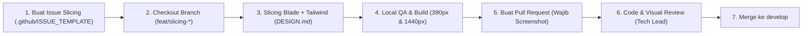

# 📘 Panduan Konvensi Issue Slicing & Workflow Frontend
**Lead Frontend Architect & Tech Lead — Web Buku Angkatan (ASCENT Tekkom 2026)**

Dokumen ini adalah pedoman baku bagi seluruh Software Engineer, Frontend Developer, dan Kontributor dalam membuat, mengelola, serta mengerjakan task slicing antarmuka web. Tujuan konvensi ini adalah memastikan setiap komponen antarmuka yang diproduksi memiliki presisi visual 100% terhadap [DESIGN.md](DESIGN.md), bebas dari kode berkualitas rendah (anti-slop), dan terintegrasi mulus ke dalam arsitektur Laravel + Tailwind CSS.

---

## 🧭 1. Siklus Kerja Slicing (End-to-End Workflow)



### Langkah 1: Pembuatan Issue
- Setiap task slicing **wajib** dibuat menggunakan template GitHub Issue: `.github/ISSUE_TEMPLATE/frontend_slicing.md`.
- Label wajib: `slicing`, `frontend`, `ui/ux`.
- Penamaan judul issue wajib seragam: `[SLICING]: <Nama Halaman / Modul Komponen>`.

### Langkah 2: Strategi Percabangan (Branching)
- Selalu percabangkan branch baru dari branch `develop` (mengacu pada [docs/CONTRIBUTING.md](docs/CONTRIBUTING.md)).
- Pola penamaan branch:
  ```bash
  git checkout develop
  git pull origin develop
  git checkout -b feat/slicing-<nama-modul-kebab-case>
  ```
  *Contoh*: `feat/slicing-landing-hero`, `feat/slicing-bento-values`, `feat/slicing-global-navbar`.

### Langkah 3: Implementasi Slicing
- Kerjakan view/komponen di direktori standar: `resources/views/` (subfolder `components/` untuk komponen modular).
- Patuhi seluruh token desain, aturan tipografi, dan batasan anti-slop dari [DESIGN.md](DESIGN.md).

### Langkah 4: Verifikasi Lokal & Linting
Sebelum membuka Pull Request, engineer wajib menjalankan:
```bash
# 1. Pastikan kompilasi aset frontend berjalan tanpa error
npm run build

# 2. Format kode PHP / Blade agar sesuai standar Laravel
vendor/bin/pint --dirty --format agent
```

### Langkah 5: Pull Request & Review
- Buat Pull Request menargetkan branch `develop`.
- Judul PR: `feat(slicing): <deskripsi singkat> (#<nomor-issue>)`.
- **Wajib melampirkan screenshot / video preview**:
  - Tampilan Desktop (lebar 1440px)
  - Tampilan Mobile (lebar 390px)

---

## 📋 2. Anatomi Format GitHub Issue Template

Setiap issue slicing wajib memuat 7 blok terstruktur berikut:

| Blok | Bagian | Tujuan & Hal yang Harus Diisi |
| :--- | :--- | :--- |
| **1** | **Deskripsi & Scope** | Nama modul, path target file Blade, dan tipe pekerjaan (Full page / Component / Polish). |
| **2** | **Referensi & Breakpoint** | Tautan mockup/stitch dan konfirmasi target viewport (`1440px` Desktop & `390px` Mobile). |
| **3** | **Design Token Checklist** | Centang token warna, tipografi, radius, dan border yang dipakai dari `DESIGN.md`. |
| **4** | **Anti-Slop Directives** | Checklist kepatuhan standar craft (larangan gradien teks, card soup, AI slop). |
| **5** | **State Handling** | Spesifikasi interaksi Default, Hover, Focus-Visible, dan Active transitions. |
| **6** | **Rincian Task Pengerjaan** | Sub-task konkret dari pembuatan markup hingga `npm run build`. |
| **7** | **Acceptance Criteria (DoD)** | Kriteria final agar task dinyatakan selesai dan siap di-merge. |

---

## 🎨 3. Ringkasan Token Desain & Mapping Tailwind CSS

Seluruh engineer wajib mengacu pada token baku di [DESIGN.md](DESIGN.md):

### A. Palet Warna (Color System)

| Token Name | HEX | Opacity / Penggunaan Khusus | Tailwind Utility Equivalent |
| :--- | :--- | :--- | :--- |
| **Canvas Background** | `#FAFAFB` | Latar belakang dasar kanvas aplikasi | `bg-[#FAFAFB]` |
| **Neutral Dark / Text** | `#514051` | Heading (`100%`), Body copy (`85%`), Border (`15%`) | `text-[#514051]`, `text-[#514051]/85`, `border-[#514051]/15` |
| **Primary Brand** | `#80bab2` | Elemen interaktif aktif (tombol, ring, filter) | `bg-[#80bab2]`, `border-[#80bab2]` |
| **Accent / Action** | `#d4d86a` | Badge clearance, tag status, notification pip | `bg-[#d4d86a]`, `text-[#514051]` |
| **Neutral Light / Surface** | `#e6e3e8` | Surface Bento card, secondary pill container | `bg-[#e6e3e8]` |

> [!CAUTION]
> Warna **Primary Brand (`#80bab2`)** HANYA digunakan untuk elemen interaktif (tombol primer, hover/active tab, fokus ring). Dilarang menjadikannya latar belakang blok container statis yang besar!

### B. Tipografi & Spacing

- **Font Sans**: `Inter` atau `Plus Jakarta Sans` (`font-sans`)
  - Display Hero: `48px – 56px` (`text-5xl` s/d `text-6xl`), Bold (`font-bold`), Tracking `-0.02em` (`tracking-[-0.02em]`).
  - Section Headings: `28px – 36px` (`text-2xl` s/d `text-4xl`), Semi-bold (`font-semibold`), Tracking `-0.02em` s/d `-0.03em`.
  - Body Text: `15px – 16px` (`text-base`), Regular (`font-normal`), Line height `1.5` s/d `1.6` (`leading-relaxed`), warna `#514051/85`.
- **Font Monospace**: `JetBrains Mono` (`font-mono`)
  - Format tag/indeks: Uppercase dengan tracking `+0.05em` (`tracking-[0.05em] uppercase text-xs`).
  - Contoh: `// 01_IDENTITY`, `[STATUS: ACTIVE]`, `BATCH_XXVI`.
- **Radius**:
  - Bento Card: `rounded-2xl` (16px).
  - Button / Pill / Tag: `rounded-lg` (8px – 10px).
- **Hairline Border**:
  - `border border-[#514051]/15` (`1px solid rgba(81, 64, 81, 0.15)`).
- **Shadow Elevation**:
  - Minimalis/flat diffused: `shadow-[0_4px_20px_rgba(81,64,81,0.04)]` atau tanpa bayangan (cukup hairline border).

---

## 🚫 4. Aturan Anti-Slop (Zero Tolerance Directives)

Setiap Pull Request yang melanggar aturan di bawah ini **akan langsung ditolak (request changes)** pada tahap review:

1. ❌ **Dilarang Teks Gradien**: Jangan gunakan `bg-clip-text text-transparent bg-gradient-to-r`. Hirarki visual harus dibangun lewat font-weight dan ukuran tipografi.
2. ❌ **Dilarang Efek Kaca Dekoratif (Glassmorphism Murahan)**: Jangan menggunakan `backdrop-blur-md` pada kontainer kosong tanpa kebutuhan fungsional fokus/proteksi layer.
3. ❌ **Dilarang Card-Soup Simetris**: Hindari layout 3 kolom identik yang monoton (ikon + judul + 2 baris teks). Gunakan grid bento asimetris dengan proporsi 60:40 atau 2:1.
4. ❌ **Dilarang Bayangan Tebal (Muddy Drop Shadows)**: Hindari `shadow-2xl` atau bayangan gelap pekat (`rgba(0,0,0,0.3)`).
5. ❌ **Dilarang Menggunakan Emoji Sebagai Ikon Sistem**: Gunakan SVG monoline stroke tunggal atau label berkurung siku monospace (contoh: `[X]`, `[+]`, `↗`).
6. ❌ **Dilarang Ilustrasi 3D AI Generik**: Seluruh aset gambar/foto yang belum final WAJIB dirender sebagai Wireframe Box `[X]` bersilang diagonal dengan label fungsional:
   ```html
   <!-- CONTOH WIREFRAME BOX PLACEHOLDER STANDAR -->
   <div class="relative w-full aspect-video border border-[#514051]/20 bg-[#e6e3e8]/30 rounded-xl flex items-center justify-center font-mono text-xs text-[#514051]/60 tracking-wider">
       [X] [ASSET: EVENT_GALLERY_01]
   </div>
   ```
7. ❌ **Dilarang Mengarang Konten Narasi**: Jangan mengarang data atau filosofi angkatan yang belum resmi. Gunakan teks resmi atau `Lorem ipsum dolor sit amet...`.

---

## 🔍 5. Checklist Kualitas Reviewer & Definition of Done (DoD)

Sebelum menekan tombol *Merge*, pastikan checklist berikut terpenuhi:

- [ ] **Fidelity**: Tampilan sesuai 100% dengan token di `DESIGN.md`.
- [ ] **Mobile Responsive**: Tidak ada horizontal scrollbar (`overflow-x`) di viewport `390px`.
- [ ] **Desktop Grid**: Tampilan di `1440px` rapi, proporsional, dan memanfaatkan ruang dengan baik.
- [ ] **Accessibility**: Focus ring tampak jelas (`outline: 2px solid #80bab2`, `outline-offset: 2px`) saat navigasi keyboard (`Tab`).
- [ ] **Selection State**: Warna blok teks aktif menggunakan `::selection` kustom (`bg-[#80bab2] text-[#514051]`).
- [ ] **Build Integrity**: Perintah `npm run build` sukses tanpa warning missing assets.
- [ ] **Code Hygiene**: Tidak ada inline styles (`style="..."`) yang tidak perlu, dan telah lolos `vendor/bin/pint --format agent`.
- [ ] **PR Documentation**: Terdapat screenshot komparasi Desktop & Mobile di deskripsi Pull Request.

---

> 💡 **Ada Pertanyaan / Butuh Klarifikasi Token?**
> Diskusikan langsung melalui issue GitHub terkait atau koordinasikan dengan Tech Lead & Lead Frontend Architect.
