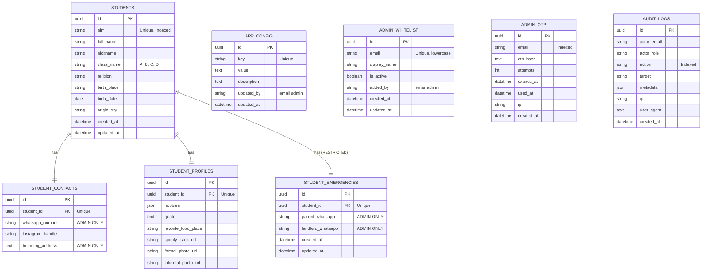
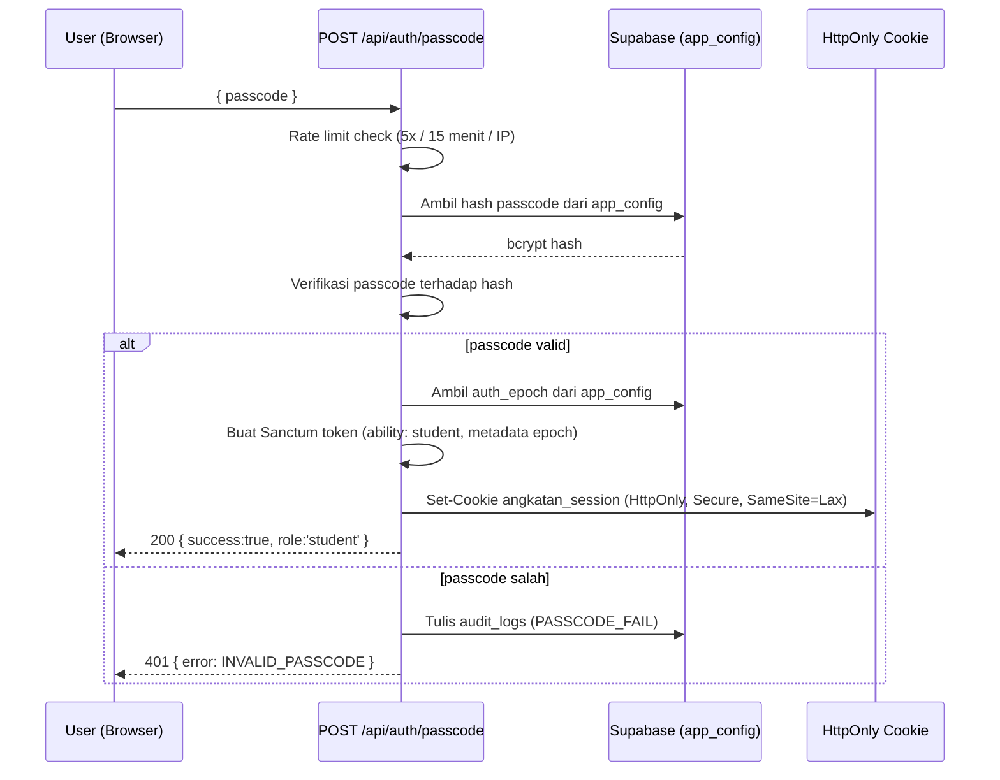
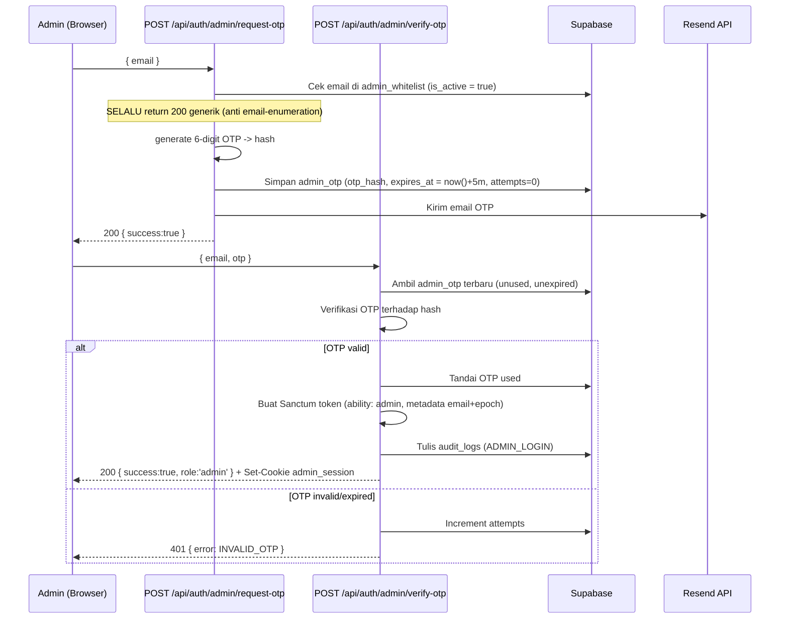

# Backend Architecture & Systems Design

Document Source of Truth arsitektur backend **Web Buku Angkatan**.

> **Prinsip dokumen ini**: dokumen ini adalah **panduan arsitektur & spesifikasi high-level**. Isinya menjelaskan *apa* dan *bagaimana secara logis*, bukan *bagaimana menulis baris kode tertentu*. Implementasi detail diserahkan ke fase koding dengan tetap mengikuti kontrak di sini.

---

## 1. Tech Stack Overview

| Layer | Technology | Infrastructure / Free Tier Provider |
| :--- | :--- | :--- |
| **Framework** | Laravel 13 | PHP Framework |
| **Admin Panel** | Filament v5 | Modern TALL-stack Admin Panel |
| **UI Layer** | Livewire v4 + Tailwind CSS v4 | Reactive frontend (dibundel Filament) |
| **Language** | PHP 8.3+ | — |
| **Database** | PostgreSQL | Supabase (Free Tier) |
| **ORM** | Eloquent ORM | Laravel Native ORM |
| **Package Manager** | Composer | — |
| **Object Storage** | S3-Compatible Storage | Cloudflare R2 (Free Tier) |
| **S3 Driver** | Laravel Storage (S3 driver) | AWS SDK via Flysystem adapter |
| **Email (OTP)** | Resend | Transactional Email via Laravel Mail |
| **Auth** | Laravel Sanctum | Token-based authentication |
| **Validation** | Form Requests | Laravel native validation |
| **Public Frontend** | Blade Templates | Server-side rendering (pemula-friendly) |
| **Deployment** | Vercel | Serverless PHP Runtime |

> **Catatan arsitektur**: Aplikasi **tidak** memakai Supabase Auth. Semua autentikasi (student passcode & admin OTP) dikelola via Laravel Sanctum dengan custom logic. Token disimpan di HttpOnly cookie. Backend mengakses Supabase PostgreSQL via Laravel database connection (Eloquent ORM dengan driver `pgsql`).

---

## 2. Database Schema & ERD

### Entity Relationship Diagram (Mermaid)



### Enums

| Enum | Nilai | Keterangan |
| :--- | :--- | :--- |
| `ClassEnum` | `A`, `B`, `C`, `D` | Implementasi via PHP backed enum + kolom `string` di DB |
| `ReligionEnum` | `ISLAM`, `PROTESTANT`, `CATHOLIC`, `HINDU`, `BUDDHA`, `KHONGHUCU`, `OTHER` | Implementasi via PHP backed enum + kolom `string` di DB |

> Tidak ada `RoleEnum` di DB — role adalah konsep aplikasi (`guest` / `student` / `admin`), bukan nilai tersimpan. Admin diidentifikasi dari `admin_whitelist.email`.

> **Pendekatan enum**: gunakan **PHP backed enum** (`app/Enums/`) dipadukan kolom `string` di DB + validasi Form Request. PostgreSQL native `ENUM` lebih sulit di-migrate; pendekatan string + enum cast Laravel lebih fleksibel dan aman untuk perubahan nilai.

### Data Dictionary

Setiap tabel dideskripsikan di bawah. Kolom `id` selalu `UUID` (PK, default `gen_random_uuid()`); `created_at`/`updated_at` adalah `TIMESTAMP` kecuali disebut lain.

**1. `students`** (Data Resmi Utama)
- `nim` — `VARCHAR(20)`, UNIQUE, INDEXED
- `full_name` — `VARCHAR(100)`
- `nickname` — `VARCHAR(50)`
- `class_name` — `VARCHAR(1)`, INDEXED (cast `ClassEnum`)
- `religion` — `VARCHAR(20)` (cast `ReligionEnum`)
- `birth_place` — `VARCHAR(100)`
- `birth_date` — `DATE`
- `origin_city` — `VARCHAR(100)`

**2. `student_contacts`** (Kontak — sebagian Admin Only)
- `student_id` — `UUID`, FK → `students.id`, UNIQUE, cascade on delete
- `whatsapp_number` — `VARCHAR(20)` — 🔒 **admin only**
- `instagram_handle` — `VARCHAR(50)` — student ✅
- `boarding_address` — `TEXT` — 🔒 **admin only**

**3. `student_profiles`** (Public Content / Vibes)
- `student_id` — `UUID`, FK → `students.id`, UNIQUE, cascade on delete
- `hobbies` — `JSON` (array of strings, cast ke array)
- `quote` — `TEXT`
- `favorite_food_place` — `TEXT`
- `spotify_track_url` — `TEXT`
- `formal_photo_url` — `TEXT` (Foto KTM background merah)
- `informal_photo_url` — `TEXT`

**4. `student_emergencies`** (Data Privat / Emergency — STRICT RESTRICTED)
- `student_id` — `UUID`, FK → `students.id`, UNIQUE, cascade on delete
- `parent_whatsapp` — `VARCHAR(20)` — 🔒 admin only
- `landlord_whatsapp` — `VARCHAR(20)` — 🔒 admin only

**5. `app_config`** (Konfigurasi Aplikasi — Admin Only)
- `key` — `VARCHAR(100)`, UNIQUE. Key yang dipakai:
  - `angkatan_passcode` → `value` = bcrypt hash passcode angkatan
  - `auth_epoch` → `value` = integer (string), di-increment untuk mencabut semua sesi
- `value` — `TEXT`
- `description` — `TEXT`
- `updated_by` — `VARCHAR(255)` (email admin yang terakhir mengubah — audit)
- `updated_at` — `TIMESTAMP` (default `now()`)

**6. `admin_whitelist`** (Daftar Email Admin)
- `email` — `VARCHAR(255)`, UNIQUE, lowercase — **whitelist per email individu**, bukan domain
- `display_name` — `VARCHAR(100)`
- `is_active` — `BOOLEAN` (default `true`) — nonaktifkan tanpa hapus
- `added_by` — `VARCHAR(255)` (email admin yang menambahkan — audit)

**7. `admin_otp`** (One-Time Password Admin — sementara)
- `email` — `VARCHAR(255)`, INDEXED
- `otp_hash` — `TEXT` — hash OTP (bcrypt), **tidak pernah plaintext**
- `attempts` — `INTEGER` (default `0`) — max 5 percobaan
- `expires_at` — `TIMESTAMP` — ~5 menit setelah dibuat
- `used_at` — `TIMESTAMP` — single-use; non-null = sudah terpakai
- `ip` — `VARCHAR(64)`

**8. `audit_logs`** (Jejak Audit — append only)
- `actor_email` — `VARCHAR(255)` — email admin (dari whitelist/token), `NULL` untuk aksi anonim
- `actor_role` — `VARCHAR(20)` — `admin` / `student` / `guest`
- `action` — `VARCHAR(64)`, INDEXED — lihat daftar di Section 9
- `target` — `VARCHAR(255)` — mis. NIM / config key
- `metadata` — `JSON`
- `ip` — `VARCHAR(64)`
- `user_agent` — `TEXT`

### Field Visibility Matrix (per Role)

| Field | guest | student | admin |
| :--- | :---: | :---: | :---: |
| Nama Lengkap, NIM, Kelas, Kota Asal | ❌ | ✅ | ✅ |
| Hobi, Quotes, Tempat Makan, Spotify | ❌ | ✅ | ✅ |
| Foto Formal & Non-Formal | ❌ | ✅ | ✅ |
| Username Instagram | ❌ | ✅ | ✅ |
| **No WhatsApp Pribadi** | ❌ | ❌ | ✅ |
| **Alamat Kost** | ❌ | ❌ | ✅ |
| **Kontak Darurat (ortu/kost)** | ❌ | ❌ | ✅ |

> **Catatan**: Landing Page (`/`) hanya menampilkan **statistik agregat** (jumlah siswa per kelas, total angkatan) — tanpa data personal apa pun. Seluruh data personal hanya terlihat setelah lolos Angkatan Passcode, dan field WA pribadi + alamat kost hanya untuk admin.

---

## 3. Database Connection & Migration Strategy

### Connection Settings (Supabase PostgreSQL)

| Parameter | Nilai | Catatan |
| :--- | :--- | :--- |
| Driver | `pgsql` | PostgreSQL |
| Host | Supabase host | dari env |
| Port (production) | `6543` | Transaction Mode Pooler |
| Port (migration) | `5432` | Direct connection |
| Database | `postgres` | default Supabase |
| SSL Mode | `require` | wajib untuk Supabase |
| Search Path | `public` | schema default |

> **Connection pooling**: gunakan Transaction Mode Pooler (port `6543`) untuk runtime produksi, dan Direct connection (port `5432`) untuk menjalankan migration. Kedua URL disediakan Supabase.

### Migration Strategy

- Setiap tabel punya **satu file migration** tersendiri di `database/migrations/`.
- Tabel: `students`, `student_contacts`, `student_profiles`, `student_emergencies`, `app_config`, `admin_whitelist`, `admin_otp`, `audit_logs`.
- Semua PK bertipe UUID (`gen_random_uuid()`), relasi `student_id` memakai cascade on delete.
- Index wajib: `students.nim` (unique), `students.class_name`, `admin_otp.email`, `audit_logs.action`.
- Urutan migration mengikuti dependency FK: `students` lebih dulu sebelum tabel anak.
- Jalankan migration ke Supabase memakai direct connection.

### Row Level Security (RLS) — Defense-in-Depth

Karena aplikasi **tidak** memakai Supabase Auth, penegakan akses utama ada di **layer aplikasi** (middleware + policies + Eloquent scoping). RLS berperan sebagai **lapis pertahanan terakhir** untuk mencegah **akses langsung** ke DB.

**Prinsip**: Aplikasi hanya mengakses DB via koneksi Laravel (Postgres privileged). RLS dikonfigurasi untuk **menolak seluruh akses dari role `anon` dan `authenticated`**, sehingga tabel hanya bisa diakses oleh koneksi privileged (role `postgres` / service role).

**Kebijakan RLS (high-level):**

1. **Aktifkan RLS** pada seluruh tabel aplikasi.
2. **Tidak membuat policy apa pun** untuk role `anon` / `authenticated` → dengan RLS aktif tanpa policy, semua akses dari kedua role otomatis ditolak (deny-by-default).
3. **Cabut (revoke) hak akses tabel** di schema `public` dari role `anon` dan `authenticated` sebagai lapis tambahan (opsional, paling ketat).
4. Backend tetap dapat membaca/menulis karena memakai koneksi privileged yang **melewati RLS**.

> **Konsekuensi penting**: Karena RLS di-bypass oleh koneksi backend, **satu-satunya penegak** pembatasan akses adalah kode aplikasi. Semua endpoint wajib melewati middleware/gate, dan query WAJIB memilih kolom secara eksplisit (tidak boleh lazy-load `student_contacts`/`student_emergencies` untuk endpoint non-admin).

---

## 4. Cloudflare R2 Storage & Upload Flow

### Storage Disk Configuration

| Parameter Disk | Nilai |
| :--- | :--- |
| Driver | `s3` |
| Key / Secret | dari env `R2_ACCESS_KEY_ID` / `R2_SECRET_ACCESS_KEY` |
| Region | `auto` |
| Bucket | env `R2_BUCKET_NAME` (`buku-angkatan-assets`) |
| Endpoint | env `R2_ENDPOINT` (`https://<account_id>.r2.cloudflarestorage.com`) |
| Public URL | env `R2_PUBLIC_DOMAIN` (`https://cdn.bukuangkatan.com`) |
| Path Style Endpoint | `false` |

### Architecture Flow Diagram (Presigned URL)

```
[ Browser ] -------- 1. POST /api/upload --------> [ Laravel Controller ]
                                                          | (ADMIN ONLY)
                                                   2. Generate S3
                                                   Presigned PUT URL
                                                          |
[ Browser ] <------- 3. Return Presigned URL <-----------+
    |
    +------------------ 4. PUT direct file binary ---------> [ Cloudflare R2 Bucket ]
                                                          |
                                                   5. Accessible via
                                                   R2 Public Custom Domain
```

> **Semua aksi upload & ganti image hanya untuk admin** (gate/policy 🛡️). Student tidak pernah mendapat presigned URL.

### Upload Logic (Pseudocode)

**A. Presigned URL (untuk endpoint `/api/upload`):**
1. Terima request dari admin (setelah lolos middleware admin).
2. Validasi `filename`, `file_type`, dan `folder` yang diizinkan.
3. Bentuk object key mengikuti konvensi: `{folder}/{nim}.jpg`.
4. Generate **presigned PUT URL** dengan masa berlaku **5 menit**.
5. Kembalikan `upload_url`, `public_url`, dan `key` ke client.

**B. Upload langsung via Filament (alternatif di panel admin):**
1. Komponen upload di Filament Resource diarahkan ke disk `r2`.
2. Tentukan direktori (`formal` / `informal`), batas ukuran (mis. 5MB), dan tipe image.
3. Setelah tersimpan, simpan URL publik ke kolom `formal_photo_url` / `informal_photo_url`.

---

## 5. Validation Layer Specification

Semua input divalidasi dengan **Laravel Form Request** classes di `app/Http/Requests/`.

### 5.1 Sanitizer Helpers

Helper function global di `app/Helpers/` (di-autoload via composer `autoload.files`):

| Helper | Aturan |
| :--- | :--- |
| `sanitizeWhatsApp()` | Buang karakter non-digit; normalisasi awalan `08…` / `+628…` / `8…` → `628…`. Hasil harus cocok `^628\d{8,12}$` |
| `sanitizeInstagram()` | Trim; buang prefix URL `instagram.com/`; buang `@` di awal; buang trailing `/` |
| `parseBirthDate()` | Terima `DD/MM/YYYY`, `YYYY-MM-DD`, atau teks → normalisasi ke ISO Date |

**Alur sanitasi WhatsApp (pseudocode):**
1. Jika input kosong → kembalikan `null`.
2. Hapus semua karakter non-digit.
3. Jika diawali `0` → ganti `0` dengan `62`.
4. Jika diawali `8` → tambahkan prefix `62`.
5. Validasi hasil terhadap regex `^628\d{8,12}$`; jika tidak cocok → `null`.

**Alur sanitasi Instagram (pseudocode):**
1. Jika input kosong → `null`.
2. Trim whitespace.
3. Buang prefix URL (`http(s)://`, `www.`, `instagram.com/`).
4. Buang `@` di awal dan `/` di akhir.
5. Kembalikan hasil; jika kosong → `null`.

**Alur parse tanggal lahir (pseudocode):**
1. Jika input kosong → `null`.
2. Jika sudah format ISO (`YYYY-MM-DD`) → kembalikan apa adanya.
3. Jika format `DD/MM/YYYY` → susun ulang ke `YYYY-MM-DD`.
4. Jika format teks (mis. `17 Agustus 2002`) → parse via library tanggal, format ke ISO.
5. Jika gagal → `null`.

### 5.2 Form Request Classes

| Form Request | Field & Rules |
| :--- | :--- |
| `StoreStudentRequest` | `nim` (required, unique:students,nim, max:20), `full_name` (required, max:100), `nickname` (required, max:50), `class_name` (required, in:A,B,C,D), `religion` (required, in:7 nilai enum), `birth_place` (required, min:2), `birth_date` (required, date), `origin_city` (required, min:2) |
| `StoreContactRequest` | `whatsapp_number` (required, regex:/^628\d{8,12}$/), `instagram_handle` (nullable, max:50), `boarding_address` (nullable, min:5) |
| `StoreProfileRequest` | `hobbies` (nullable, array), `quote` (nullable, max:500), `favorite_food_place` (nullable, max:200), `spotify_track_url` (nullable, url), `formal_photo_url` (nullable, url), `informal_photo_url` (nullable, url) |
| `StoreEmergencyRequest` | `parent_whatsapp` (required, regex:/^628\d{8,12}$/), `landlord_whatsapp` (nullable, regex:/^628\d{8,12}$/) |
| `PasscodeRequest` | `passcode` (required, string) |
| `AdminEmailRequest` | `email` (required, email, lowercase) |
| `VerifyOtpRequest` | `email` (required, email), `otp` (required, digits:6) |
| `PaginationRequest` | `page` (integer, min:1), `limit` (integer, min:1, max:100), filter/sort opsional |

**Alur sanitasi di Form Request (pseudocode):**
1. Override method `prepareForValidation()`.
2. Jalankan sanitizer (WhatsApp/Instagram) terhadap input mentah.
3. Merge hasil sanitasi kembali ke data request.
4. Lanjutkan ke aturan validasi normal.

---

## 6. Deployment & Vercel Configuration

### Vercel Deployment Strategy

| Aspek | Konfigurasi |
| :--- | :--- |
| Runtime | PHP serverless (`vercel-php`) |
| Entry point | `api/index.php` sebagai front controller |
| Routing | Semua request diarahkan ke front controller |
| Cache config/route/view | Diarahkan ke `/tmp` (ephemeral) |
| Log channel | `stderr` |
| Filesystem | Read-only kecuali `/tmp` |

> ⚠️ **Catatan Vercel serverless**: Filesystem read-only kecuali `/tmp`. Semua cache & compiled view harus diarahkan ke `/tmp`. Session driver **harus** `cookie` atau `database` (bukan `file`).

**Alur request di Vercel (pseudocode):**
1. Request masuk ke `api/index.php` (front controller).
2. Bootstrap Laravel app + kernel.
3. Handle request → kirim response.
4. Terminate kernel (cleanup).

### Mandatory Environment Variables

Set di **Vercel Dashboard → Settings → Environment Variables**:

| Variable | Description |
| :--- | :--- |
| `APP_NAME` | `Buku Angkatan` |
| `APP_ENV` | `production` |
| `APP_KEY` | Generated application key |
| `APP_DEBUG` | `false` |
| `APP_URL` | `https://bukuangkatan.vercel.app` |
| `DATABASE_URL` | Supabase pooler connection string (port 6543) |
| `DB_CONNECTION` | `pgsql` |
| `SANCTUM_STATEFUL_DOMAINS` | `bukuangkatan.vercel.app` |
| `SESSION_DRIVER` | `cookie` |
| `SESSION_DOMAIN` | `.vercel.app` |
| `RESEND_API_KEY` | API key Resend |
| `MAIL_MAILER` | `resend` |
| `MAIL_FROM_ADDRESS` | `no-reply@bukuangkatan.com` |
| `R2_ACCESS_KEY_ID` | Cloudflare R2 Access Key |
| `R2_SECRET_ACCESS_KEY` | Cloudflare R2 Secret Key |
| `R2_BUCKET_NAME` | `buku-angkatan-assets` |
| `R2_ENDPOINT` | `https://<account_id>.r2.cloudflarestorage.com` |
| `R2_PUBLIC_DOMAIN` | `https://cdn.bukuangkatan.com` |

> **Catatan**:
> - Passcode angkatan & `auth_epoch` **tidak** di env, melainkan di tabel `app_config`, agar bisa diubah tanpa redeploy.
> - Resend bisa via Laravel Mail driver `resend` atau SMTP.

---

## 7. Application Access Control (RBAC)

### Model 3 Role

| Role | Mekanisme Autentikasi | Cakupan Akses |
| :--- | :--- | :--- |
| `guest` | Tanpa auth | Hanya Landing Page (`/`) |
| `student` | Angkatan Passcode → Sanctum token (HttpOnly cookie) | Directory, Galeri, Detail Profil |
| `admin` | Whitelist email + OTP (Resend) → Sanctum token (HttpOnly cookie) | Admin Panel Filament + seluruh data termasuk `student_emergencies` |

Hierarki: `guest < student < admin`. Admin **secara implisit lolos** semua guard `student`.

### Route Access Matrix

| Route (UI) | guest | student | admin |
| :--- | :---: | :---: | :---: |
| `/` Landing Page | ✅ | ✅ | ✅ |
| `/unlock` (form passcode) | ✅ | — | — |
| `/students/{nim}` Detail Profil | ❌ | ✅ | ✅ |
| `/directory` Direktori Angkatan | ❌ | ✅ | ✅ |
| `/gallery` Galeri Foto | ❌ | ✅ | ✅ |
| `/admin/*` Panel Filament | ❌ | ❌ | ✅ |

### Endpoint Access Matrix

| Endpoint | guest | student | admin |
| :--- | :---: | :---: | :---: |
| `POST /api/auth/passcode` | ✅ | — | — |
| `DELETE /api/auth/passcode` | ✅ | ✅ | ✅ |
| `POST /api/auth/admin/request-otp` | ✅ | ✅ | ✅ |
| `POST /api/auth/admin/verify-otp` | ✅ | ✅ | ✅ |
| `POST /api/auth/admin/logout` | ✅ | ✅ | ✅ |
| `GET /api/auth/session` | ✅ | ✅ | ✅ |
| `GET /api/public/stats` | ✅ | ✅ | ✅ |
| `GET /api/classes` | ✅ | ✅ | ✅ |
| `GET /api/students` | ❌ | ✅ | ✅ |
| `GET /api/students/{nim}` | ❌ | ✅ | ✅ |
| `GET /api/gallery` | ❌ | ✅ | ✅ |
| `POST /api/upload` | ❌ | ❌ | ✅ |
| `GET /api/admin/emergencies` | ❌ | ❌ | ✅ |
| `GET /api/admin/audit-logs` | ❌ | ❌ | ✅ |
| `PATCH /api/admin/config` | ❌ | ❌ | ✅ |
| `/api/admin/students/*` (CRUD) | ❌ | ❌ | ✅ |

### 7.1 Alur Autentikasi Angkatan Passcode (Role `student`)



**Keputusan teknis:**
- **Laravel Sanctum** untuk token management (HttpOnly cookie).
- Passcode diverifikasi **server-side**; hash di `app_config` hanya dibaca backend.
- Cookie **HttpOnly** → tidak bisa dibaca JavaScript (mitigasi XSS).
- **Rate limiting** via Laravel rate limiter / middleware `throttle`.
- Token metadata menyimpan `epoch` — dipakai untuk pencabutan sesi (Section 9).
- Logout: revoke token + clear cookie.

### 7.2 Alur Autentikasi Admin (Whitelist + OTP via Resend)



**Keputusan teknis:**
- **Whitelist per email individu** di `admin_whitelist` (bukan per domain). Dikelola via Filament Resource `AdminWhitelistResource`.
- **Anti email-enumeration**: `request-otp` selalu membalas `200` generik, terlepas email ada/tidak.
- OTP: 6 digit, expiry 5 menit, max 5 percobaan, single-use.
- Sesi admin = **Sanctum token** dengan ability `admin`, konsisten dengan student.
- Cabut akses admin: set `admin_whitelist.is_active = false` + increment `auth_epoch`.

### 7.3 Middleware Guard (Pseudocode)

**Komponen middleware:**
- `EnsureStudentRole` — memastikan token punya ability `student`.
- `EnsureAdminRole` — memastikan token punya ability `admin`.
- `CheckAuthEpoch` — membandingkan epoch token dengan epoch saat ini.

**Alur `CheckAuthEpoch`:**
1. Ambil user/token aktif dari request.
2. Baca `auth_epoch` saat ini dari `app_config` (dengan cache).
3. Jika token menyimpan metadata `epoch` dan `epoch ≠ currentEpoch` → **tolak (401) + revoke token**.
4. Selain itu → lanjutkan request.

**Alur `EnsureAdminRole`:**
1. Cek user memiliki ability `admin`.
2. Jika bukan → tolak (403).

**Registrasi middleware (deskriptif):**
- Daftarkan alias middleware di `bootstrap/app.php` (Laravel 11+ style): `student`, `admin`, `check.epoch`.
- Pasang alias sesuai kelompok route (route student → `student` + `check.epoch`; route admin → `admin` + `check.epoch`).

**Konvensi status code:** `401` = belum terautentikasi, `403` = terautentikasi tapi role kurang.

### 7.4 Konvensi Cookie & Sanctum Token

| Item | Nilai |
| :--- | :--- |
| Student token cookie | `angkatan_session` (HttpOnly, Secure, SameSite=Lax, Path=/, 7 hari) |
| Admin token cookie | `admin_session` (HttpOnly, Secure, SameSite=Strict, Path=/, 8 jam) |
| Token abilities (student) | `['student']` |
| Token abilities (admin) | `['admin']` |
| Token metadata | `['epoch' => currentEpoch, 'email' => email]` (untuk admin) |
| Passcode hashing | bcrypt (`app_config` key `angkatan_passcode`) |
| OTP hashing | bcrypt (`admin_otp.otp_hash`) |

---

## 8. Route Map & Page Structure

```
/                         → Landing Page (PUBLIC) - Blade view
                            - Hero section, statistik agregat, pengenalan singkat
/unlock                   → Form Angkatan Passcode (PUBLIC) - Blade view
/students/{nim}           → Student Detail Page (PROTECTED - student) - Blade view
                            - Bio, quotes, foto, hobi, sosmed (tanpa WA & alamat kost)
/directory                → Angkatan Directory (PROTECTED - student) - Blade view
                            - Direktori lengkap + filter kelas + pencarian
/gallery                  → Galeri Foto (PROTECTED - student) - Blade view
                            - Grid foto formal & non-formal
/admin                    → Filament Panel (RESTRICTED - admin)
/admin/students           → StudentResource (CRUD + upload/ganti foto)
/admin/emergencies        → EmergencyContacts page (view-only, audit READ_EMERGENCIES)
/admin/config             → ConfigManagement page (ganti passcode + bump epoch)
/admin/audit-logs         → AuditLogResource (view-only)
/admin/admin-whitelists   → AdminWhitelistResource (manage whitelist)
```

> **Catatan**: Halaman login admin dihandle oleh **Filament panel login** (dapat dikustomisasi agar pakai email + OTP, bukan password).

### Struktur Folder Laravel 13 + Filament v5

```
app/
├── Enums/                  # ClassEnum, ReligionEnum
├── Filament/
│   ├── Pages/              # EmergencyContacts, ConfigManagement
│   └── Resources/          # Students, AuditLogs, AdminWhitelists (Resource + Pages + Schemas + Tables)
├── Http/
│   ├── Controllers/        # Auth, Public, Directory, Student, Gallery, Upload
│   ├── Middleware/         # EnsureStudentRole, EnsureAdminRole, CheckAuthEpoch
│   ├── Requests/           # Form Request validation
│   └── Resources/          # API Resource (JSON shaping)
├── Models/                 # Student, StudentContact, StudentProfile, StudentEmergency,
│                           # AppConfig, AdminWhitelist, AdminOtp, AuditLog
├── Policies/               # StudentPolicy, AdminWhitelistPolicy
├── Services/               # AppConfigService, OtpService, AuditService
├── Mail/                   # OtpMail
├── Jobs/                   # Queue jobs (mis. upload foto)
└── Helpers/                # sanitizers.php (autoload via composer files)

database/
├── migrations/             # 8 migration (1 per tabel)
├── seeders/                # DatabaseSeeder, AuthSeeder, StudentSeeder
└── factories/              # StudentFactory

resources/views/            # Blade: landing, unlock, directory, gallery, students/show, layouts
routes/
├── web.php                 # Route Blade (public + student)
├── api.php                 # Route JSON API (auth, public, admin)
└── console.php

api/index.php               # Vercel entrypoint
vercel.json                 # Vercel deployment config
```

---

## 9. Audit Logging & Security Hardening

### 9.1 Daftar Aksi yang Dicatat (`audit_logs.action`)

| Action | Kapan |
| :--- | :--- |
| `ADMIN_LOGIN` | OTP admin berhasil diverifikasi |
| `ADMIN_LOGIN_FAIL` | Verifikasi OTP gagal / email tidak whitelisted |
| `PASSCODE_FAIL` | Percobaan passcode salah |
| `ROTATE_PASSCODE` | Passcode angkatan diganti |
| `READ_EMERGENCIES` | Akses data kontak darurat |
| `MUTATE_STUDENT` | Create/update/delete data siswa |
| `WHITELIST_CHANGE` | Perubahan `admin_whitelist` |

**Alur penulisan audit (pseudocode):**
1. Setiap aksi sensitif memanggil `AuditService`.
2. Service mengekstrak `actor_email`, `actor_role`, `ip`, dan `user_agent` dari request.
3. Service menyimpan record baru ke `audit_logs` (append-only, tanpa update/delete).

### 9.2 Token Epoch — Pencabutan Sesi Seketika

Sanctum token bersifat persistent sampai expiry. Solusinya: metadata `epoch` di token yang dibandingkan dengan `app_config.auth_epoch`.

- Setiap token (student & admin) menyimpan `epoch` saat diterbitkan.
- Middleware `CheckAuthEpoch` membandingkan `token.epoch === currentEpoch`; jika tidak sama → **tolak (401) + revoke token**.
- **Rotasi passcode / cabut akses admin** → increment `auth_epoch` → **semua sesi lama langsung mati**, tanpa ganti `APP_KEY` dan tanpa redeploy.

### 9.3 Prinsip Keamanan Lain

- **Rate limiting**: passcode (5x/15m/IP), request-otp (per email & IP), verify-otp (max 5 percobaan per OTP).
- **Anti-enumeration**: `request-otp` selalu `200` generik.
- **Secret separation**: master secret (`APP_KEY`, DB creds) di env; operational secret (passcode, epoch) di `app_config` (bisa rotasi instan).
- **HttpOnly + Secure + SameSite** untuk semua cookie token.
- **Query scoping**: endpoint non-admin **wajib** memilih kolom eksplisit atau pakai API Resources; `student_contacts.whatsapp_number`, `boarding_address`, dan seluruh `student_emergencies` tidak boleh di-return di endpoint student/public.
- **Model `$hidden`**: sembunyikan field sensitif (mis. `otp_hash`) dari serialization/Filament.

---

## 10. Tabel `app_config` & Manajemen Passcode

Passcode angkatan disimpan sebagai **bcrypt hash** di `app_config`, bukan plaintext di env.

**Data awal yang perlu di-seed** (`app_config`):

| key | value | deskripsi |
| :--- | :--- | :--- |
| `angkatan_passcode` | bcrypt hash passcode | Shared secret akses directory & galeri |
| `auth_epoch` | `1` (integer) | Epoch sesi; increment untuk mencabut semua sesi |

**Aturan operasional:**
- **Baca/ubah hanya via backend** (koneksi privileged); `anon`/`authenticated` ditolak RLS.
- Ganti passcode: via Filament Page `ConfigManagement` atau `PATCH /api/admin/config` → bcrypt hash baru + increment `auth_epoch`. Tanpa redeploy.
- Seeder/CLI menghasilkan hash bcrypt dari passcode plaintext.

**Manajemen whitelist admin** (via Filament Resource `AdminWhitelistResource`):
- Menambah admin: isi `email`, `display_name`, `is_active = true`.
- Mencabut akses: set `is_active = false` pada email terkait, lalu increment `auth_epoch` agar sesi aktif langsung mati.
